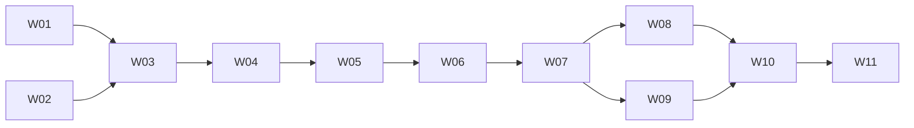

# Autotrade implementation slices

Status: planned work, not completed implementation. No GitHub implementation issues have been
published by this document. The dependency IDs below are local design references.
Read [system design](autotrade-system-design.md) and its linked contracts before implementing.

Each slice delivers a demonstrable paper/synthetic path and its regression tests.
Use the existing unittest, SQLite, audit, execution and macOS isolation facilities where suitable.
Do not introduce real broker traffic, service restarts or new infrastructure to demonstrate a slice.
The original free profile and historical results remain separately versioned and unchanged.

## W01: Reproduce live decision preparation from a complete trace

Blocked by: none. Covers D7 and the shared-observation prerequisite.

Deliver the same account-submission events from live-input fixtures and recorded-input fixtures
through shared preparation code. Capture sequence, receipt, decision clocks and idle clocks.
Preserve legacy recording semantics and identify incomplete evidence explicitly.

- [ ] Equal-time observations and delayed decisions preserve original order and logical time.
- [ ] Candidate features/counts use each account's own policy, holdings and pending state.
- [ ] Identical trace/configuration/initial state produces identical intents and outcomes.
- [ ] Existing duplicate, future-mutation, partial-fill and no-borrowing checks remain valid.

Demo: one synthetic trace runs through both adapters and produces equal saved account results.

## W02: Preserve a position's immutable strategy version through promotion

Blocked by: none. Covers D3.

Pin artifact digests to intents and positions using an offline paper account. Switch the
new-entry pointer while an old-version position and dispatched request remain open.

- [ ] Old positions, late fills and partial exits retain original management rules.
- [ ] Unsent retired entry intents are invalidated without releasing uncertain external exposure.
- [ ] New versions cannot overwrite or add to a differently owned same-symbol exposure.
- [ ] Referenced artifacts cannot be removed; rollback changes new entries only.

Demo: promote between entry and confirmation; the late fill keeps the original strategy owner.

## W03: Recover a durable paper account without duplicate effects

Blocked by: W01, W02. Covers D1.

Persist layered cash, positions, owners, reservations, outcomes and financial cursor atomically.
Reuse transaction/backup concepts without attaching legacy fixed-capital initialization to the
new account schema. Restore an interrupted scenario in a fresh process.

- [ ] Every documented crash point recovers the same economic account state.
- [ ] Duplicate evidence and repeated recovery never duplicate cash or quantity.
- [ ] Corrupt/old checkpoints and missing trace/artifact dependencies remain visible blockers.
- [ ] Backups preserve prior losses and require later evidence before returning to readiness.

Demo: kill after a partial-fill commit, restart twice, and reconcile identical cash/reservations.

## W04: Enforce fixed risk policy and durable stop before paper dispatch

Blocked by: W03. Covers D2 and the execution gate required by D9.

Use explicitly labelled synthetic policy values to exercise reservations, working exposure,
uncertain exposure, pause and stop. User values for live deployment remain unconfigured.

- [ ] Both reservation and dispatch check current risk/operating generations.
- [ ] Concurrent strategy/risk exits cannot reserve the same sellable quantity twice.
- [ ] Missing policy cannot be interpreted as unlimited real-money permission.
- [ ] Configured breach actions handle partial results without reversal or overselling.
- [ ] A stop survives restart and cannot be cleared by data recovery or AI output.

Demo: pause between decision and dispatch; new exposure is rejected and genuine late fills apply.

## W05: Resolve uncertain operations and cancel/fill races with a fake adapter

Blocked by: W04. Covers D5.

Drive the execution journal through a fault-injectable local adapter. Include lost create
response, duplicate response, delayed acceptance, partial fill, modification and cancellation.
Use internal normalized states rather than inventing provider guarantees.

- [ ] Dispatch is journaled first; ambiguous outcomes retain reservation and never blind-retry.
- [ ] Related operation identifiers preserve lineage without duplicate economic executions.
- [ ] A cancellation request does not release funds before the actual remainder is resolved.
- [ ] A second exit or replacement cannot reuse quantity from an unresolved sell request.
- [ ] Old fenced dispatchers cannot authorize new exposure after restart or stop.

Demo: the adapter accepts a request but loses its response; recovery finds one order and one fill.

## W06: Reconcile a recovering account against moving external fixtures

Blocked by: W05. Covers D6 and external-evidence recovery for D1.

Read fake account/order/execution snapshots with pagination, delayed fills and manual activity.
Establish a stable evidence cut and append sourced adjustments rather than overwrite balances.

- [ ] Duplicate/reordered executions are applied once across operation lineage.
- [ ] Unknown activity, incomplete pagination and uncorrelated submissions block affected risk.
- [ ] Deposits, FX, costs and corporate-action changes preserve funding-adjusted performance.
- [ ] Stop/pause remains active after otherwise successful reconciliation.

Demo: a changing snapshot becomes reconciled after its overlapping execution window is complete.

## W07: Compare frozen candidates and promote only an eligible version

Blocked by: W06. Covers D4 and D8.

Run independent incumbent/candidate accounts on one trace with a frozen evaluation contract.
Calculate a verdict from persisted metrics and evidence; promote atomically for new entries.
Use synthetic contract values in tests. Missing production criteria yield unqualified status.

- [ ] The same artifact cannot change during evaluation; every observed candidate is retained.
- [ ] Reused/development data cannot be relabelled as an unseen final segment.
- [ ] Missing evidence, uncertain valuation and failed risk gates cannot produce eligibility.
- [ ] Concurrent promotions and policy/runtime changes invalidate stale promotion authority.

Demo: one candidate passes fixture criteria, another fails, and only the matching generation wins.

## W08: Accept AI improvement artifacts without granting execution authority

Blocked by: W07. Covers AI authority for D2, D3, D4 and D8.

Feed synthetic model proposals through the optimizer input path. Restrict outputs to permitted
strategy scope and evaluate them under the independent controller. No model call is required.

- [ ] Proposals cannot edit evidence, evaluation/risk policy, active pointers or account state.
- [ ] Executable candidate code is isolated from credentials, network and control-state writes.
- [ ] Engineering-worker permissions are not inherited by the strategy optimizer.
- [ ] Identical evidence does not trigger repeated AI work; time changes alone do not trigger it.

Demo: a valid rule proposal enters evaluation while a proposal changing risk policy is rejected.

## W09: Operate pause, resume, rollback and actionable local alerts

Blocked by: W07. Covers D9.

Expose local audited commands and status for the paper path. Preserve blocking reasons across
restart and demonstrate rollback without changing old position owners or financial history.

- [ ] Duplicate/stale-generation commands do not repeat effects or erase unrelated blockers.
- [ ] Resume checks all required state and reports unresolved reasons.
- [ ] Emergency-stop acknowledgement reports in-flight and uncertain operations honestly.
- [ ] Local incidents deduplicate; external alert delivery remains unconfigured until specified.

Demo: stop, restart, reject premature resume, resolve the cause, and explicitly resume once.

## W10: Verify the full US paper operating path under combined faults

Blocked by: W08, W09. Covers end-to-end interaction of D1-D9.

Combine delayed data, unknown order response, partial fill, stop, crash, recovery and promotion
in one fixture campaign. Bind results to source/artifact/policy/trace digests.

- [ ] No duplicate economic effect, lost owner, unexplained cash or unauthorized promotion.
- [ ] Crash-point and prefix comparisons agree with uninterrupted reference outcomes.
- [ ] Evidence distinguishes technical success, paper performance and missing live coverage.
- [ ] This slice does not enable a real-account adapter or claim real fill feasibility.

Demo: a saved reproducible campaign demonstrates all nine areas with explicit limitations.

## W11: Apply the same operating contracts to KR paper trading

Blocked by: W10. Covers the agreed KR/US target, with US completed first.

Add explicit KR currency/session/fee/price/quantity fixtures and mixed-market account tests.
Verify market-specific provider contracts before adding connected market-data evidence.

- [ ] KRW and USD buying power remain separate; display FX cannot create spendable funds.
- [ ] Market-qualified identity prevents symbol collisions and timezone/session ambiguity.
- [ ] Costs, settlement availability and supported operations are market-specific.
- [ ] Both markets pass the same recovery, ownership, risk and operating invariants.

Demo: one account with both market scopes survives a partial-fill/restart scenario correctly.

## Future activation prerequisites, not an implementation ticket

Before real-account work, separately verify broker idempotency/correlation, execution identity,
lineage, snapshot semantics and current KR/US operation support from official evidence.
Require explicit real-account authorization, approved capital/risk/evaluation values and the
ability to observe/reconcile actual outcomes. The current market-data allowlist stays intact.
No listed completed paper slice alone grants real-account access or starts real trading.
