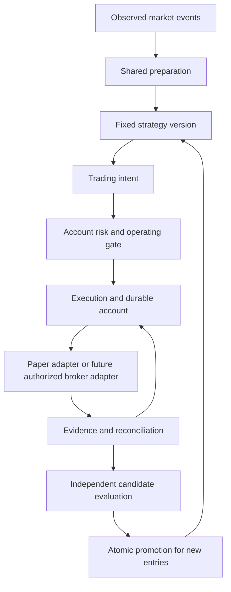

# Autotrade operating design

Status: design baseline and implementation plan, not implemented capabilities.
This design completes the nine operating areas requested during the project review.
Implementation observations were checked against source baseline `9de301f` on 2026-11-04.
It extends [Project direction](project-direction.md) and the
[shared observation design](shared-observation-design.md).
It does not change the current market-data-only authorization or start any process.

## Scope and evidence

The target supports KR and US through Toss, completing and validating the US path first.
Shared identities include account, environment, market, symbol, and native currency.
Use native-currency cash and exact quantities; FX-based reporting does not create spendable cash.
Market-specific sessions, costs, settlement availability, quantity and price rules belong to the
execution adapter. Reuse rules only after confirming that they apply to both markets.

| Existing source | Verified capability | Missing target capability |
| --- | --- | --- |
| `papertrade/store.py` | SQLite transactions, unique trade keys, position revisions, verified database backups | Durable layered intents, reservations and version ownership |
| `papertrade/service.py` | Dead-worker detection, incident handling, process identity checks | Persistent trading pause and reconciled execution recovery |
| `tools/async_layered_paper.py` | Reserved cash, delayed confirmation, partial fills and strategy-family ownership | Crash-safe account recovery and immutable strategy-version ownership |
| `tools/autotest_supervisor.py` | Durable test jobs and reviewed GitHub publication; invalid review guards | Runtime strategy validation and promotion |
| `papertrade/api.py` | OAuth and market-data allowlist | Any authorized real-account execution or reconciliation adapter |

These are separate implementations. Legacy database recovery does not already protect the
in-memory layered account. A healthy SQLite file does not prove economic reconciliation.

## Nine-area coverage

| ID | Area | Authoritative design | Completion evidence required |
| --- | --- | --- | --- |
| D1 | Recovery | [Execution and recovery](execution-recovery-design.md#recovery) | Crash-point tests preserve money, ownership and deduplication |
| D2 | Risk breach behavior | [Operating controls](operational-control-design.md#risk-policy) | Configured actions and reservations enforced before dispatch |
| D3 | Strategy versions | [Strategy lifecycle](strategy-lifecycle-design.md#versions-and-position-ownership) | Old positions retain their original executable version |
| D4 | Promotion | [Strategy lifecycle](strategy-lifecycle-design.md#promotion-contract) | Frozen evaluation contract produces a reproducible verdict |
| D5 | Order lifecycle | [Execution and recovery](execution-recovery-design.md#order-lifecycle) | Ambiguous submission and cancel/fill races do not duplicate exposure |
| D6 | Reconciliation | [Execution and recovery](execution-recovery-design.md#reconciliation) | Broker evidence and local accounting agree at a known cut |
| D7 | Data faults | [Execution and recovery](execution-recovery-design.md#market-data-faults) | Stale, missing and reordered observations cannot create invented fills |
| D8 | Fair validation | [Strategy lifecycle](strategy-lifecycle-design.md#evaluation-integrity) | Evaluation leakage and selective reporting are detected |
| D9 | Operating controls | [Operating controls](operational-control-design.md#operating-state) | Stop survives restart; resume clears every blocking reason |

## Responsibility map

This is a responsibility map, not a mandate to create a class for every box.
Prefer existing transaction, audit and execution facilities; add no message broker, ORM,
external database, or retry framework merely to implement this design.
The strategy process receives market facts and its own allowed state, not broker credentials.
It returns intents. Only the execution path can reserve funds or mutate financial state.

AI strategy improvement can change selection, assignment, entry/exit rules and sizing proposals.
It cannot change risk policy, evidence, evaluation criteria, promotion decisions, stop controls,
execution accounting, or broker adapters. The current automated engineering worker has broader
test/fix permissions; it is not the future strategy optimizer's authority template.

## Decisions still requiring user values

| Required value | When it is needed | Behavior while absent |
| --- | --- | --- |
| Initial live capital and enabled markets/sessions | Before future live activation | Live activation unavailable; paper research remains labelled paper |
| Live risk thresholds and action for each threshold | Before future live activation | No new real-money exposure |
| Evaluation horizon, evidence sufficiency and improvement margin | Before automatic promotion | Candidate remains unqualified; AI cannot invent a pass |
| Evaluation risk limits and allowed mark uncertainty | Before automatic promotion | Report metrics without promotion eligibility |
| Alert destination and acknowledgement rules | Before unattended operation | Record local incidents; do not claim external delivery |
| Verified broker recovery/correlation contract | Before broker adapter activation | Uncertain outcomes remain unresolved and reserved |

No numerical loss limit, minimum trade count, AI-call cap, or promotion threshold is invented here.
Unset real-money controls do not alter the unrestricted free paper profile.
These inputs are configuration decisions, not reasons to stop independent paper implementation.

## Implementation and verification

[Implementation plan](autotrade-implementation-plan.md) defines reviewable vertical slices,
dependencies, demonstrations, and acceptance tests for every area above.
The first complete path uses recorded/synthetic observations and a fault-injectable paper
execution adapter. No real-account adapter is installed or enabled by this documentation.
Use failures at actual execution and restart interfaces, not tests that recompute implementation.
Preserve all old ledgers, datasets, source versions, failed experiments, and costs.

An implemented slice is not a validated strategy. Passing paper tests is not evidence of live
broker execution or profitable performance. Each evidence manifest records precisely its scope.
