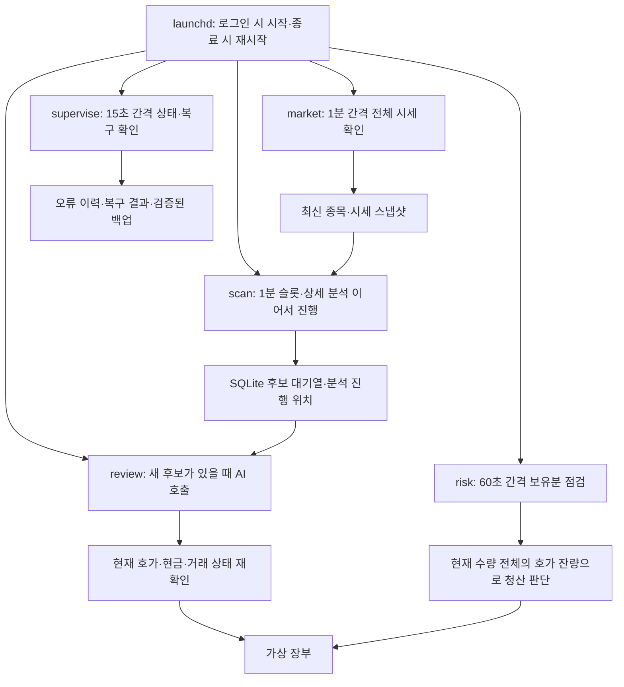

# 가상 1,000달러 모의 운용

운용 원칙은 두 가지다.

1. 가상 자금으로 장부에만 기록한다.
2. 관측한 자료와 설명 가능한 근거가 있을 때만 거래한다.

실제 주문 기능은 없다. 토스는 OAuth 인증과 시세·종목 정보 조회만 사용한다.

## 실행 구조



AI 응답 대기와 보유분 점검은 별도 프로세스다. AI가 오래 걸려도 점검 프로세스는 기다리지 않는다.
장부 변경은 SQLite 트랜잭션으로 처리한다. 상태 조회도 하나의 일관된 시점으로 읽는다.
역할별 실행 잠금으로 중복 실행을 막는다. 전체 종목의 상세 분석이 1분 안에 끝난다고 가정하지 않는다.

| 파일 | 역할 |
|---|---|
| `api.py` | 허용된 토스 조회 경로, 인증과 시세·종목 자료 |
| `strategy.py` | 완성 봉·돌파·거래량·상대 강도와 체결·청산 근거 |
| `engine.py` | 전체 종목 검색, 순차 분석, 현재 호가의 모의 거래 |
| `ai.py` | AI 실행, 판단·수량 검증과 호출별 사용량 기록 |
| `usage.py` | 읽기 전용 계정 한도·모델 목록 조회와 모델 선택 |
| `store.py` | 현금·미결제 대금·보유분·거래·판단 근거·사용량 |
| `audit.py` | 오류 식별자·원인·시각·재시도·복구 이력과 비밀 값 제거 |
| `service.py` | 독립 실행·작업 회수·상태 점검·알림·백업·서비스 설정 |
| `__main__.py` | 상태·감사·실행 명령 |

## 삭제한 인위적 제한

- 하루 AI 호출 횟수와 토큰 예산을 두지 않는다.
- AI 추론의 프로그램 타임아웃과 입력·출력 크기 상한을 두지 않는다.
- 분석 종목 수, 한 번에 검토할 후보 수, 보유 종목 수에 상한을 두지 않는다.
- 종목별 고정 투자 비중과 거래당 고정 손실 비율을 강제하지 않는다.
- 저가주·레버리지 ETF·우선주를 유형이나 가격만으로 배제하지 않는다.
- 시세 API의 프로그램 자체 호출 예산과 분봉 페이지 수 상한도 없다.

계정·모델 자체의 사용 한도와 최대 문맥 길이는 서비스가 정한다.
토스의 요청당 심볼 200개·랭킹 100개 같은 실제 API 규격과 요청 간격은 지킨다.
이 숫자는 전체 종목 수 제한이 아니다. 전체 목록을 요청 규격에 맞춰 나눠 조회한다.

## 종목과 거래 근거

- KOSPI·KOSDAQ·KR_ETC와 NYSE·NASDAQ·AMEX·US_ETC의 전체 ACTIVE 목록을 일별로 받는다.
- 전체 종목의 현재 시세를 조회한다. 가상 현금으로 1주도 살 수 없는 종목은 매수 후보가 될 수 없다.
- 거래대금·거래량·상승률·하락률 랭킹은 분석 순서를 정하는 데만 쓴다.
- 랭킹 시각이 없거나 오래됐으면 순서 결정에 쓰지 않고 전체 종목 분석을 계속한다. 실제 봉·호가의 유효성 검사는 유지한다.
- 순서를 정한 뒤 임의의 상위 N개에서 자르지 않는다.
- 토스의 분봉 시각은 종료 시각이다. `[시각-1분, 시각)`으로 변환하고 원래 시각도 보존한다.
- 현재 전략은 완성된 1분봉 5개로 만든 5분봉만 분석한다. 미완성 봉이나 미래 가격은 쓰지 않는다.
- 같은 시각의 종목·기준 ETF 봉과 설정된 비교 시각(현재 15분 전)의 봉으로 상대 강도를 비교한다.
- 거래일이 바뀌면 조정 분봉을 다시 받는다. 이전 캐시와 분할 뒤 가격을 섞지 않는다.
- 현재 실험 전략은 5분봉의 최근 3개 봉 고점 돌파, 평균 이상 거래량, 최근 15분의 시장 대비 상대 강도를 근거로 삼는다.
- 미국 기준 ETF는 SPY, 국내는 069500이다. 모든 섹터를 대표하는 완벽한 비교 기준은 아니다.
- 호가 차이와 돌파선 이후의 추격 정도도 거래 근거의 유효성에 포함한다.
- 초기 손절은 최근 3개 봉 최저가와 매수가 - 1.5ATR 중 낮은 값이다. 목표는 초기 위험 거리의 2배다.
- 30분이 지나도 0.5R에 못 미치면 시간 청산한다. 정규장 종료 15분 전에는 당일 청산을 시도한다.
- 이 첫 전략은 정규장에서 진입한다. 종료 30분 전부터 새 진입을 피한다. 시간외에는 시장을 관찰한다.
- 이 시간·가격 조건은 현재 선택한 단타 전략이다. 계정이나 AI 사용량 제한이 아니다.
- 매수 수량은 AI가 현금·손절 거리·호가 잔량과 근거를 보고 정한다. 강제 30% 배분이나 1% 손실 제한은 없다.
- 각 매수의 시세 시각·봉 근거·AI 사유·수량·손절·목표·예상 손실을 장부에 남긴다.
- 각 매도의 실제 관측 호가와 청산 사유를 기록한다. 확인하지 않은 시점의 목표가·손절가 체결을 만들지 않는다.
- 공시·뉴스 자동 검증은 아직 없다. `news_verified=false`를 전달한다. 확인하지 않은 재료를 만들지 않는다.

전체 종목의 상세 분봉 분석을 한 번에 끝내는 시간은 시장 규모와 API 속도에 달려 있다.
각 후보는 발견되는 대로 검토한다. 한 바퀴가 끝날 때까지 매수 판단을 미루지 않는다.
전체 시세와 보유분은 각각 별도 프로세스가 60초 간격으로 확인한다. AI를 호출하지 않는다.
상세 분석은 최신 시세 스냅샷을 활용하고 기존 진행 위치를 이어간다.
실행 시작 간격은 60초다. 조회가 60초를 넘기면 중복 실행하지 않고 완료 후 다음 회차를 진행한다.
정규장 밖에서는 이 전체 시세 조회를 쉬고 기존 시간외 관찰 주기를 유지한다.
AI 추론에는 자체 시간 제한이 없다. 대기 중에도 실행 상태를 기록한다.
네트워크 장애·운영체제 중단 동안의 점검이나 체결은 보장하지 않는다. 놓친 시각의 체결을 나중에 꾸미지 않는다.

## 모델과 사용량

기본은 로컬 규칙에 따른 자동 선택이다. 모델 선택 자체는 AI를 호출하지 않는다.
매번 Codex의 실제 모델 카탈로그와 지원 추론 강도를 확인한다.

| 상황 | 모델·추론 강도 |
|---|---|
| 가상 연결 테스트 | `gpt-6-luna`, `low` |
| 일반 후보 판단 | `gpt-6.1-sol`, `medium` |
| ATR/가격 3% 이상 또는 비슷하게 평가된 후보 비교 | `gpt-6-astra`, `high` |

이 분기는 실험용 판단 규칙이다. 더 높은 수익을 보장하는 검증 결과는 아니다.
사용자 전역 모델 설정을 수정하지 않는다. `ai.model_selection=current`이면 기존 모델·추론 설정을 쓴다.
카탈로그에 없는 모델이나 지원되지 않는 추론 강도는 실행하지 않는다.
카탈로그 조회가 실제 모델 사용 권한을 보장하지는 않는다. 완료된 호출이 해당 요청의 접근을 검증한다.

매 AI 호출 전후로 다음을 저장하고 콘솔에 출력한다.

- 선택 모델·추론 강도·선택 이유
- 입력·출력·캐시 토큰과 실제 처리 시간
- 계정의 한도별 사용률·남은 비율·초기화 시각

정확한 남은 토큰 개수는 제공되지 않으므로 `null`로 기록한다.
계정 한도는 이 프로젝트와 다른 Codex 사용이 공유한다. 표시 비율이 정수 단위라 작은 사용량은 반영되지 않을 수 있다.
한도 조회가 실패하면 알 수 없다고 기록한다. 남은 양을 추정해서 만들지 않는다.
읽기 전용 한도·카탈로그 조회 연결에는 응답 대기 20초와 프로세스 종료 대기 5초가 있다.
이 대기는 AI 추론을 중단하거나 AI 호출을 차단하는 시간 제한이 아니다.
AI의 잘못된 답변은 그 요청의 체결에 쓰지 않는다. 다음 새 신호까지 영구 차단하지 않는다.
동일한 관측 이벤트의 중복을 막는다. 중단된 호출은 승인을 재사용하지 않는다.
남은 JSONL에서 사용량을 복구한다. 확인하지 못한 사용량은 `null`과 `usage_known=false`로 남긴다.
계정 한도 부족이나 AI 실패가 다음 새 신호를 영구 차단하지 않는다. 오래된 판단을 반복 호출하지 않는다.

## 현실적인 장부

- 가상 현금 1,000달러에서 시작한다. 1주 단위로 현금 범위에서 거래한다.
- 매수는 현재 매도 호가, 매도는 현재 매수 호가를 사용한다. 보이는 잔량과 비용을 반영한다.
- 투자경고는 AI에 전달할 자료다. 실제 거래 정지나 VI는 즉시 체결로 가정하지 않는다.
- 매도 대금은 미결제 상태여도 즉시 다음 모의 매수에 재사용한다. 매수 가능 금액은 미사용 가상 현금 전체다.
- T+1·T+2 정보는 인출 구분용으로만 유지한다. 보유 주식 평가액을 추가 현금으로 중복 계산하지 않는다.
- 미국 편도 10bp, 국내 편도 1.5bp, 국내 매도 추가 20bp, 국내 환전 편도 10bp를 가정한다.
- 이 비용과 세금은 실제 토스 조건을 조회해 검증한 값이 아니다.
- 국내 거래는 시세 조회한 USD/KRW 환율로 환산한다. 서버의 `validUntil`을 체결 직전에도 확인한다.
- 평가와 손절·익절은 보유 수량 전체를 소화하는 매수 호가의 평균값과 비용을 사용한다. 잔량이 부족하면 체결을 만들지 않는다.
- 국내 종가 단일가 시간에는 즉시 체결하지 않는다. 캘린더의 `singlePriceAuctionStartTime`을 사용한다.
- 평가가 오래됐으면 `mark_quality=stale`로 표시한다. 기업행사 확인이 필요하면 평가와 청산을 보류한다.
- 이 구현의 테스트 통과는 전략 수익성 검증이나 백테스트가 아니다.

## 실행 명령

```zsh
cd /Users/elsholtzia/Projects/Finance
python3 -m papertrade status
python3 -m papertrade usage
python3 -m papertrade doctor
python3 -m papertrade scan US
python3 -m papertrade tick
```

`status`는 장부, `usage`는 현재 한도와 모델 목록이다. 둘 다 AI 추론을 호출하지 않는다.
`scan`은 분석만 한다. `tick`은 수집 후 후보를 대기열에 넣는다. 실행 중인 `review`가 검토와 모의 진입을 맡는다.

```zsh
python3 -m papertrade health
python3 -m papertrade audit --emergency
python3 -m papertrade audit --open
python3 -m papertrade audit --events
python3 -m papertrade audit --incident INCIDENT_ID
python3 -m papertrade audit --output state/audit-export.json
python3 -m papertrade backup
python3 -m papertrade ai-check
```

`audit`에는 오류 식별자·발생 횟수·시각·관련 종목·요청 경로·서버 오류 코드·요청 ID·재시도 시점이 나온다.
`--emergency`는 DB를 열지 않고 비상 기록을 읽는다.
`--events`와 내보내기에는 시세 조회·AI 사용량·오류·복구의 시간 순서도 포함한다.
연결 테스트는 실제 토큰을 사용한다. 가상 종목에 SKIP만 요청한다.

## 자동 복구 범위

| 상황 | 처리 |
|---|---|
| HTTP 429·일시적 연결 오류·5xx | API 그룹별 요청 상태를 공유하고 서버의 대기 시간을 지킨 뒤 분석 위치에서 재시도 |
| HTTP 401·토큰 만료 | 비밀 파일 잠금 아래 캐시를 갱신하고 인증 실패 요청을 한 번 다시 조회 |
| HTTP 403·IP 권한 문제 | 5분 이상 대기 후 연결 재확인. 해결 전에는 외부 조치 필요 상태와 알림 |
| 한 종목 조회·형식 오류 | 해당 종목을 기록하고 다른 종목 점검 진행. 현재 조회로 다시 확인할 때만 복구 처리 |
| 프로세스 종료 | launchd 재시작. 죽은 소유자의 작업·AI 사용량을 회수하고 이전 승인을 폐기 |
| AI 장기 대기 | 타임아웃으로 죽이지 않음. 별도 점검 프로세스는 계속 실행 |
| 오래된 후보·호가·환율 | 체결하지 않음. 다음 관측에서 다시 판단 |
| DB 접근 오류 | 가능한 경우 별도 `state/emergency-audit.jsonl`에 기록 |
| 장부 손상·누락 | 새 1,000달러 장부로 덮지 않음. 검증된 백업을 보존하고 복원 확인 필요 |
| 분할·배당·상장 폐지 | 아래 기업행사 절차로 처리. 확인되지 않은 현금이나 수량을 만들지 않음 |

가격 이탈·호가 차이 확대 등 정상적인 매수 거절은 `rejected_observation`으로 분리한다. 열린 장애 목록에서 제외한다.
기본 상태는 `retrying`, 외부 조치가 필요하면 `waiting_external`, 근거가 필요하면 `needs_evidence`다.
실제 성공을 관측한 뒤에만 `recovered`와 별도 복구 이벤트를 남긴다.
별도 감독 프로세스는 하루 한 번 온라인 백업을 만들고 무결성을 검사한다.
해결되지 않은 조치 필요 오류는 macOS 알림을 시도한다. 알림 성공 여부도 저장한다.
알림 표시 여부는 macOS 알림 설정에 달려 있다. 자동으로 코드를 생성하거나 금융 판단을 바꾸지는 않는다.

## 기업행사와 장부 보존

허용된 토스 시세 API에는 확인된 분할·배당·상장 폐지 지급 내역 API가 없다.
진입 전 비조정·조정 일봉의 기준 비율을 저장한다. 다음 거래일의 비율이 변하면 확인을 요구한다.
이 검사는 모든 기업행사를 완전하게 찾아내는 장치가 아니다.
출처가 확인된 사실은 `corporate-action` 명령으로 적용할 수 있다.
출처 URL 형식 확인은 사람의 사실 검증을 대신하지 않는다.

```zsh
python3 -m papertrade corporate-action verified-action.json
```

입력의 공통 필드는 `event_key`, `symbol`, `kind`, `effective_date`, `source`다.
`source`에는 확인한 HTTPS 공시 URL을 넣는다. `event_key`가 같으면 중복 반영하지 않는다.

- `split`: `new_shares`, `old_shares`, `adjustment_factor`. 수량과 가격 기준을 조정한다. 총 취득 원가는 보존한다.
- `dividend`: 확인된 세후 가상 달러 총액 `amount_usd`와 실제 지급 가능 시각 `available_at`. 기준 비율 변경이 있으면 `adjustment_factor`도 필요하다.
- `settlement`: 확인된 `amount_usd`, `available_at`. 상장 폐지 등의 확정 지급을 기록하고 보유분을 닫는다.

분할 뒤 단주가 생기면 단주 정산 근거를 확인할 때까지 자동 청산을 보류한다.
장부가 손상됐을 때 백업으로 무조건 되돌리면 최신 거래가 사라질 수 있다. 자동으로 과거 장부를 덮어쓰지 않는다.

## 서비스 설치와 중지

```zsh
python3 -m papertrade launchd
```

이 명령은 프로젝트 `launchd` 폴더에 역할별 plist 다섯 개를 만든다. 생성만으로 활성화하지 않는다.
운용 시 `~/Library/LaunchAgents`에 설치하고 `launchctl bootstrap`으로 등록한다.
`RunAtLoad`와 `KeepAlive`를 사용한다. 로그인 뒤 자동 실행하며 비정상 종료 뒤 다시 시작한다.
현재 설치된 역할은 `market`, `scan`, `risk`, `review`, `supervise`다.

```zsh
launchctl bootout "gui/$(id -u)/com.elsholtzia.papertrade.market"
launchctl bootout "gui/$(id -u)/com.elsholtzia.papertrade.scan"
launchctl bootout "gui/$(id -u)/com.elsholtzia.papertrade.risk"
launchctl bootout "gui/$(id -u)/com.elsholtzia.papertrade.review"
launchctl bootout "gui/$(id -u)/com.elsholtzia.papertrade.supervise"
python3 -m unittest discover -s tests -v
```

## 접근 경계와 공식 문서

키와 토큰은 `~/.config/secrets`의 권한 600 파일에 보관한다. 비밀 값은 출력하거나 AI에 전달하지 않는다.
AI에는 셸·앱·플러그인·웹 검색을 주지 않는다. 비밀 폴더와 장부 폴더 접근도 OS에서 막는다.
AI의 명령·URL·경로를 실행하지 않는다. AI는 판단 데이터를 반환하고 Python만 가상 장부를 수정한다.
계좌·자산·주문·주문 조회·정정·취소·조건주문 경로는 HTTP 요청 전의 허용 목록 검사에서 거부한다.
`/api/v1/orderbook`은 시세 호가 조회다. `/api/v1/orders`를 호출하지 않는다.

[토스 API 문서](https://developers.tossinvest.com/docs),
[공식 OpenAPI 명세](https://openapi.tossinvest.com/openapi-docs/latest/openapi.json),
[Codex 앱 서버 문서](https://learn.chatgpt.com/docs/app-server).

## 적극적인 모의 실험 v2

사용자 요청에 따라 `momentum-experiment-v2`를 적용했다. 수익성이 입증된 설정은 아니다.

| 조건 | 이전 v1 | 현재 v2 |
|---|---|---|
| 봉 길이 | 30분 | 5분 |
| 돌파 비교 | 이전 6개 봉·3시간 | 이전 3개 봉·15분 |
| 거래량 | 이전 평균의 1.5배 | 이전 평균 이상 |
| 시장 대비 수익률 | 60분 | 15분 |
| 허용 호가 차이 | 0.15% | 0.5% |
| 돌파 뒤 진입 범위 | 0.5ATR | 1.5ATR |
| 약한 흐름의 시간 청산 | 120분 | 30분 |
| 신규 진입 마감 | 폐장 60분 전 | 폐장 30분 전 |

현재 시각·완성 봉·보유 수량 전체의 호가 잔량·가상 현금·거래 정지 검증은 유지한다.
v2는 ATR·돌파·상대 강도에 필요한 최근 거래 구간을 조회한다. 장중에는 보통 분봉 한 페이지로 분석한다.
새 전략 적용 시 기존 분석 진행 위치를 다시 시작한다. 가상 자금과 과거 거래 내역은 유지한다.
각 신호의 탈락 단계는 `signal_evaluation`에 남긴다.
체결에는 전략 버전과 당시 청산 규칙을 남긴다. 후속 설정 변경이 기존 보유분의 시간 청산 기준을 바꾸지 않는다.
청산 시 `paper_trade_review`에 비용 반영 손익·계획 위험 대비 손익·실제 점검에서 관측한 평가 범위를 기록한다.
이 기록을 다음 AI 판단에도 전달한다. 관측 사이의 최고·최저 가격이나 학습 효과를 만들어내지는 않는다.

사용자 요청으로 결제 대기와 매수 가능 금액을 분리했다. `buying_power_usd`가 새 매수 기준이다. 매도대금을 재사용해도 과거 손익과 총자산은 보존한다.
