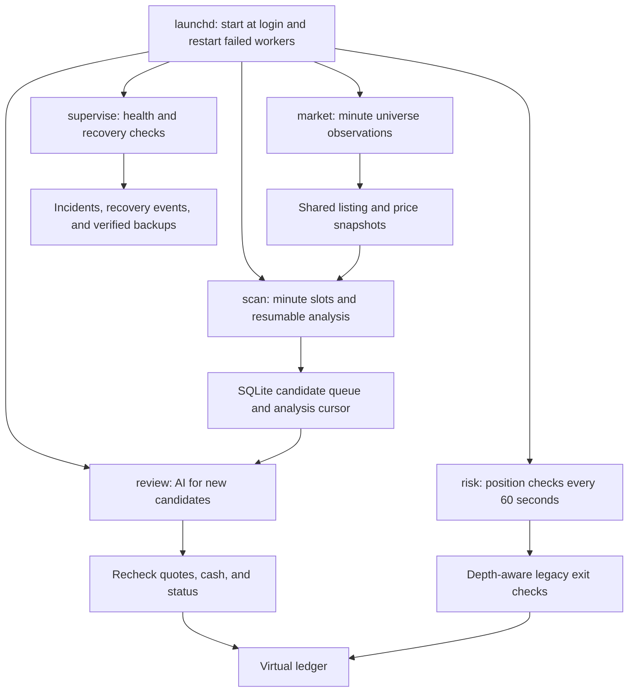

# Historical v1/v2 virtual trading guide

This guide preserves the earlier implementation for comparison. Its session, cash, depth,
whole-share, and corporate-action requirements do not apply to the default free v3 profile.
See [the current README](../../README.md) and [experiment instructions](../../AGENTS.md).
Historical examples below describe earlier behavior, not current service activation or model advice.

The original experiment used USD 1,000 of virtual capital and required observed data with an
explainable hypothesis. Toss access was limited to OAuth and market/stock information.
There was no real brokerage execution capability.

## Process architecture



AI waiting and position monitoring run in separate processes. SQLite transactions protect ledger
changes and consistent status snapshots. Per-role locks prevent duplicate workers.
The design does not assume detailed analysis of the entire universe completes within a minute.

| Module | Responsibility |
|---|---|
| api.py | Allowlisted Toss paths, authentication, market and stock information |
| strategy.py | Completed-bar signals, volume, relative strength, and legacy fill/exit rules |
| engine.py | Universe discovery, sequential analysis, and virtual quote-based fills |
| ai.py | Model execution, decision/quantity validation, and per-call usage |
| usage.py | Read-only quota/catalog requests and local model selection |
| store.py | Cash, settlement metadata, positions, trades, decisions, and usage |
| audit.py | Incident identifiers, causes, retries, recovery, and secret redaction |
| service.py | Independent workers, job recovery, health, notifications, backups, and service files |
| __main__.py | Status, audit, and command entry points |

## Removed local resource caps

The experiment removed daily AI-call/token budgets, inference timeouts, prompt/output size caps,
universe/candidate/holding caps, fixed allocation percentages, and fixed per-trade loss ratios.
Penny stocks, leveraged ETFs, and preferred shares were not excluded solely by type or price.
Market-data request budgets and page-count caps were also removed.
Provider quotas, context windows, batch formats, and pacing remained external constraints.
Request-level symbol or ranking limits did not limit the full universe; requests were batched.

## Historical symbol and signal processing

- Read full ACTIVE lists for KOSPI, KOSDAQ, KR_ETC, NYSE, NASDAQ, AMEX, and US_ETC.
- Fetch the universe's prices. Legacy entry candidates had to afford one share with virtual cash.
- Use turnover, volume, gain, and loss rankings only to prioritize analysis, never to truncate it.
- Ignore stale or untimestamped rankings while continuing full-universe analysis.
- Preserve Toss minute-bar end timestamps and map legacy internal intervals to `[time-1m, time)`.
- Build completed five-minute bars from five completed minute bars; never use future prices.
- Align symbol and benchmark bars with the configured relative-strength reference timestamp.
- Refresh adjusted bars on a new trading day rather than mixing pre-/post-split cache values.
- The v2 signal used a prior-three-bar breakout, average-or-higher volume, and 15-minute relative strength.
- Use SPY for US and 069500 for KR as imperfect broad-market benchmarks.
- Include observed spread and breakout-chasing distance in legacy signal validity.
- Set the initial stop to the lower of the prior three-bar low and entry minus 1.5ATR.
- Set the target at twice the initial risk distance.
- Attempt a time exit after 30 minutes below 0.5R and an exit 15 minutes before regular close.
- Enter during regular sessions and avoid new entries during the final 30 minutes.
- These were strategy settings, not AI or account usage caps.
- Let AI size whole-share entries from cash, stops, depth, and the hypothesis; do not force fixed allocations.
- Record source time, evidence, rationale, quantity, stop, target, and estimated risk for entries.
- Record observed exit quotes and reasons. Do not invent stop/target executions between observations.
- News/catalyst verification was unavailable; retain `news_verified=false` rather than invent evidence.

Full analysis time depended on universe size and API speed. Review candidates as discovered rather
than waiting for a complete pass. Market and position observations had separate 60-second start
cadences and did not invoke AI. Reuse shared snapshots and analysis cursors.
If a request exceeded the cadence, finish before starting another run. Legacy session filtering
paused broad observations outside regular hours while retaining the older extended-hours checks.
AI inference had no local timeout. No checks or fills were guaranteed during OS/network downtime.

## Historical model routing and usage

Local routing used the available model catalog and supported reasoning settings without inference.
The recorded routing examples were `gpt-6-luna`/`low` for a synthetic check,
`gpt-6.1-sol`/`medium` for ordinary candidates, and `gpt-6-astra`/`high` for high ATR/price ratios
or close candidate comparisons. These were experimental choices, not verified profit improvements
or current model recommendations.

Do not change global model settings. With `ai.model_selection=current`, retain the configured model
and effort. Reject missing models or unsupported efforts. Catalog visibility does not prove access;
a completed request verifies access for that request.

Record model/effort/reason, input/output/cached tokens, duration, quota percentages, and reset times
around calls. Exact remaining token counts were unavailable and remained null.
Quota is shared with other account activity; rounded percentages can hide small changes.
A failed metadata lookup means unknown usage, not an invented estimate.
The read-only metadata connection had transport/exit waits distinct from inference timeouts.

Reject malformed decisions for that request without permanently blocking future new signals.
Deduplicate observation events and discard approvals from interrupted calls.
Recover usage from available JSONL; preserve null and `usage_known=false` when unverified.
Quota or inference failures must not permanently prevent later independent signals.

## Legacy accounting assumptions

- Start with virtual USD 1,000 and buy whole shares within unused cash.
- Buy at observed asks and sell at bids, with displayed depth and assumed costs.
- Deliver investment warnings as context; do not assume immediate fills during halts or VI.
- Reuse unsettled sale proceeds. Keep T+1/T+2 metadata for withdrawal timing only.
- Do not count existing position value as additional cash.
- Assume US one-way costs of 10bp; KR one-way 1.5bp, sale tax 20bp, and conversion 10bp.
- These assumed costs were not verified against the user's actual brokerage terms.
- Convert KR values with observed USD/KRW and check `validUntil` immediately before filling.
- Mark and evaluate full position quantities with depth-weighted bids and costs.
- Do not assume immediate fills during the KR closing auction; use its calendar timestamp.
- Mark old valuations `mark_quality=stale` and defer action-dependent legacy work pending evidence.
- Passing implementation tests did not establish profitability or a validated backtest.

## Historical commands

```zsh
python3 -m papertrade status
python3 -m papertrade usage
python3 -m papertrade doctor
python3 -m papertrade scan US
python3 -m papertrade tick
python3 -m papertrade health
python3 -m papertrade audit --emergency
python3 -m papertrade audit --open
python3 -m papertrade audit --events
python3 -m papertrade audit --incident INCIDENT_ID
python3 -m papertrade audit --output state/audit-export.json
python3 -m papertrade backup
python3 -m papertrade ai-check
```

`status` inspects the ledger and `usage` reads account/catalog metadata without inference.
`scan` analyzes; `tick` can enqueue work for an active reviewer.
Audit records include incident counts/times, symbols, paths, server codes, request IDs, and retries.
`--emergency` reads without the ledger DB. Events/exports include observation, usage, error, and
recovery timelines. `ai-check` uses real model tokens for a synthetic nontradable SKIP request.

## Recovery behavior

| Situation | Historical response |
|---|---|
| 429, connection failure, or 5xx | Shared group pacing and server-directed waits, then resume the cursor |
| 401 or token expiry | Locked refresh and one retry of the failed authenticated request |
| 403 or IP authorization failure | At least five minutes before rechecking; record external action needed |
| Symbol response/format error | Record and continue; recover only on a verified successful observation |
| Process exit | launchd restart, stale job/usage recovery, and discarded prior approval |
| Long AI inference | Keep independent observation workers running without killing inference |
| Stale candidate, quote, or FX | No legacy fill; reconsider on a new observation |
| DB access failure | Separate emergency JSONL when possible |
| Missing/damaged ledger | Preserve verified backups and require recovery confirmation |
| Split, dividend, or delisting | Apply only evidenced actions; invent no cash or quantities |

Separate ordinary rejection as `rejected_observation`, not an open outage.
Incident states include `retrying`, `waiting_external`, and `needs_evidence`.
Set `recovered` and emit recovery events only after observed success.
The supervisor was designed for daily verified online backups and unresolved-incident macOS
notifications. Notification delivery depends on OS settings and is recorded separately.
Recovery does not generate new code or silently change financial decisions.

## Corporate actions and ledger preservation

The allowed provider paths supplied no verified split/dividend/delisting payment ledger.
Store the adjusted/unadjusted daily-price ratio at entry and flag later changes for evidence.
This is not complete corporate-action detection. Apply verified facts with:

```zsh
python3 -m papertrade corporate-action verified-action.json
```

Common fields are `event_key`, `symbol`, `kind`, `effective_date`, and `source`.
Use a verified HTTPS disclosure URL as `source`; URL syntax alone is not fact verification.
An existing `event_key` prevents duplicate application.

- `split`: `new_shares`, `old_shares`, and `adjustment_factor`; preserve total acquisition cost.
- `dividend`: verified net virtual `amount_usd` and `available_at`, plus an adjustment factor if required.
- `settlement`: verified `amount_usd` and `available_at`; close the affected position after final payment.

Defer automatic disposal of split fractions until settlement evidence is available.
Never overwrite newer trades with an old backup without verifying their preservation.

## Service files and shutdown

```zsh
python3 -m papertrade launchd
```

This generates five role-specific plist files in `launchd/`; generation does not activate them.
Authorized operation installs them in `~/Library/LaunchAgents` and uses `launchctl bootstrap`.
RunAtLoad and KeepAlive support login startup and recovery after failures.
The roles are market, scan, risk, review, and supervise. To unload them:

```zsh
launchctl bootout "gui/$(id -u)/com.elsholtzia.papertrade.market"
launchctl bootout "gui/$(id -u)/com.elsholtzia.papertrade.scan"
launchctl bootout "gui/$(id -u)/com.elsholtzia.papertrade.risk"
launchctl bootout "gui/$(id -u)/com.elsholtzia.papertrade.review"
launchctl bootout "gui/$(id -u)/com.elsholtzia.papertrade.supervise"
python3 -m unittest discover -s tests -v
```

## Access boundary and references

Store credential files with mode 600 under `~/.config/secrets`; never print them or send them to AI.
The AI process has no shell, app, plugin, or web tools and cannot read secrets or the ledger.
Treat responses as data. Only Python updates the virtual ledger.
Reject account, asset, order, order-history, amendment, cancellation, and conditional-order paths
before HTTP. `/api/v1/orderbook` is market data; `/api/v1/orders` is forbidden.

[Toss documentation](https://developers.tossinvest.com/docs),
[official OpenAPI specification](https://openapi.tossinvest.com/openapi-docs/latest/openapi.json),
and [historical app-server reference](https://learn.chatgpt.com/docs/app-server).

## v1/v2 strategy comparison

These were exploratory settings, not demonstrated profit improvements.

| Condition | v1 | v2 |
|---|---|---|
| Bar size | 30 minutes | 5 minutes |
| Breakout lookback | Six bars / three hours | Three bars / 15 minutes |
| Relative volume | 1.5x prior average | At least prior average |
| Relative-strength lookback | 60 minutes | 15 minutes |
| Maximum spread | 0.15% | 0.5% |
| Post-breakout entry range | 0.5ATR | 1.5ATR |
| Weak-flow time exit | 120 minutes | 30 minutes |
| Entry cutoff | 60 minutes before close | 30 minutes before close |

The legacy implementation kept time, completed-bar, full-depth, cash, and trading-status checks.
Fetch the recent trading window required for ATR, breakout, and relative strength.
Reset analysis cursors on a strategy change while preserving cash and trade history.
Record rejection stages as `signal_evaluation` and preserve the strategy version and exit rules
at entry. Later configuration changes must not retroactively alter old position time exits.
At exit, save cost-adjusted profit, profit relative to planned risk, and valuation ranges actually
seen by checks in `paper_trade_review`. Deliver those records to later AI reviews without inventing
between-observation highs/lows or claiming an unverified learning effect.
Separate buying power from withdrawal settlement metadata while preserving prior results and assets.
