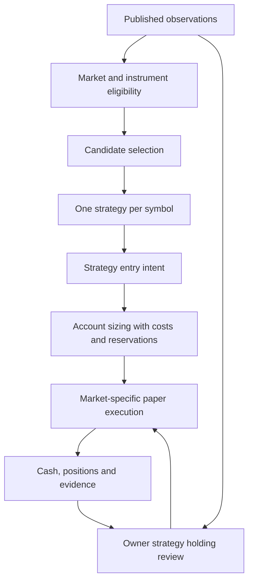

# KR and US strategy design within Toss capabilities

Revised design dated 2026-11-04. Implementation and live evidence remain separate.
This is the active design for broker-constrained paper validation. The historical free simulation
retains its own experiment contract. The supported interface is established in
[Toss capability evidence](toss-capability-evidence.md).

## Capability contract

Every run freezes a capability snapshot with source URL, retrieval date, specification version,
content hash, market, instrument, currency, session, quantity mode, order type and costs.
A broker app feature becomes an automated capability only when the public API documents its
corresponding request and restrictions. A documented operation remains untested until an
appropriately authorized integration test supplies evidence.

The four evidence states are documented supported, documented unavailable, unverified, and
locally verified. A missing source produces an unverified capability. It never becomes permission to
invent a fill. Ordinary execution uses the intersection of API support, broker rules,
instrument eligibility, session eligibility, available cash and the selected experiment policy.

Current access remains OAuth and market-data/stock-information only. Public descriptions of
account, order and execution-event APIs inform future contracts. They do not authorize calling
those endpoints, subscribing to personal events, or sending real orders.

## Market contracts

| Concern | KR | US |
| --- | --- | --- |
| Cash and reporting | Spend KRW. Current test capital KRW 100,000 | Spend available USD. Translate to KRW only with attributed FX |
| Quantity | Integer shares, including sells | Whole shares or the separate supported fractional mode |
| Initial instruments | Verified ordinary stocks | Verified ordinary stocks with confirmed mode eligibility |
| Products pending verification | ETF/ETN tax class, leveraged/inverse products, unknown classifications | Leveraged/inverse products and unknown classifications |
| Baseline session | Domestic continuous regular-session policy on integrated SOR | US regular continuous session |
| Other sessions | Auctions and extended sessions require their own tested session contract | Day, premarket and after-hours require their own tested contract |
| Fractional execution | Unavailable for this KR execution contract | API amount-based USD market buy. Supported fractional quantity market sell. Instrument and time restrictions apply |
| Fractional window | Not applicable | Regular opening through one hour before regular close, according to official session data |
| Sizing when capital is insufficient | Zero shares and an explicit unaffordable decision | Zero whole shares, or a preselected eligible fractional mode meeting its minimum amount |

Session restrictions in the baseline are design choices for the first controlled comparison.
The evidence matrix states the wider provider support. Use provider schedules and actual dates,
including daylight saving, holidays and shortened sessions, rather than a hardcoded KST clock.
The API provides integrated domestic sessions and SOR routing, without a selectable venue.
Apply the chosen regular continuous policy only where session and instrument evidence supports
it. KR closing-auction observations must have their own execution model. Sampling a last trade during
an auction cannot establish a continuous-market fill. At a test cutoff, publish remaining
positions and pending orders without inventing liquidation.

The US quantity mode is fixed before creating an intent. Whole-share orders use documented
quantity and price increments. Fractional buys use the API's USD amount field and fractional
sells use the supported quantity field. Keep mutually exclusive request fields exclusive.
Validate minimum amount, quantity precision, per-symbol eligibility and session immediately
before simulated dispatch. Source the exact field names and bounds from the evidence snapshot.
The schema establishes support but does not establish every minimum amount or per-symbol
fractional eligibility. The broker service states a USD 1 minimum. Treat its API applicability
as a dependency to verify. The app KRW 1,000 minimum does not create an API KRW amount field.
Use whole-share trend as the initial US baseline and a separately labelled fractional trend
candidate once its eligibility contract is verified. A breakout requiring a limit price uses
whole-share execution. Choose the mode before evaluation, rather than switching after seeing
which mode would have performed better.

A fractional position may need to wait until its next supported session for an exit. Keep that
exposure visible. Strategies requiring an executable overnight or late-session exit use a
compatible mode or remain ineligible.

A KRW budget, converted reporting value or unsettled/uncertain proceeds is not automatically
spendable USD. Record FX observations, conversion fees and simulated conversion time. Future
real-money buying power must be established through separately authorized account evidence.
Paper cash reservations model the chosen cash-only settlement policy explicitly.

## Shared layers

Candidate selection observes the full available universe without a strategy-specific symbol
cap. Exclude held and pending-entry symbols from new entry selection, while continuously
reviewing their existing positions. Subscription capacity limits observation coverage, not the
set of instruments that can ever become candidates.

Assign one fixed strategy version to each symbol and retain it until the position is flat.
A candidate disappearing from selection does not stop exit evaluation. Partial fills keep their
owner and remaining cash/quantity reservations. Missing or stale inputs produce an uncertainty
state, rather than a fabricated strategy invalidation. A new assignment can occur after full
exit and resolution of outstanding intents.

## Observation and selection

1. Use shared REST price batches for whole-universe discovery. Record each source timestamp,
   receipt timestamp and coverage gap. A sweep is an interval of observations.
2. Obtain actual completed OHLCV bars for strategy features. Preserve when each bar became
   available. Last-price samples provide sampled ranges only.
3. Protect held and pending symbols in WebSocket subscriptions, then allocate remaining
   provider capacity to candidates. Record REST-only coverage and its delay.
4. Merge initial REST values and lossy WebSocket updates using source/receipt evidence.
   Validate stale, duplicate and future quotes. KR integrated crossed quotes can be legitimate
   across venues. Classify this ambiguity and avoid claiming executable arbitrage. Reconcile
   bars through REST.
5. Select unusual movement relative to each symbol's own past distribution, plus fresh spread,
   available volume and affordability. Test the proposed 5-minute movement/range versus prior
   60-minute history against an all-eligible baseline. History shortages remain explicit.

Candidate refresh and continuous holding review have distinct clocks. Completed-bar entry
features can refresh on a minute or five-minute boundary. Fresh quote events handle existing
intent confirmations and exits. Parameter choices and feature clocks are frozen per comparison.
The API labels one-minute candles by their end time. Adapters must preserve that convention
and receipt time. KR zero-volume carried-price bars and absent US no-trade bars have different
meanings. The non-NXT KR closing bar can be revised through 16:00. Store revisions as newly
available evidence. Existing code that adds a minute to a provider end timestamp needs a
regression test before reuse.

US quotes and trades cover a subset of venues and are not NBBO. Minute highs/lows may contain
non-investor-executable prints without a correction flag. Use close-based trend features for
the first US candidate. Treat high-based breakouts as research-only until the effect of those
prints is measured and entry confirmation is supported by observed quotes. Volume features
represent the observed venue subset, and minute volumes do not reconstruct consolidated daily
volume. These restrictions follow the official FAQ linked in the evidence matrix.

Order-flow imbalance, exact queue position and reconstructed tick-complete volume require data
that the current lossy feed cannot establish. Strategies depending on those features are outside
this baseline.

## Strategy families and market fit

These rules define candidates for testing. Their profitability and optimal parameters are
unverified. Use the same observation cut and execution model for each candidate.

| Family | Entry hypothesis | Holding and exit hypothesis | Market application |
| --- | --- | --- | --- |
| Trend | Positive completed 5- and 15-minute returns with a persistent path and affordable entry | Maintain the positive 15-minute regime. Exit on its confirmed invalidation | First common KR/US baseline. Short oscillations must clear market-specific round-trip costs |
| Breakout | Completed observations establish a prior high. A later fresh price exceeds it with observed volume/spread support | Retain the entry range boundary. Exit on confirmed failure of that range | KR excludes auction/VI uncertainty. US treats session transitions separately |
| Rebound | Prior 15-minute decline followed by positive 5-minute recovery below the prior mean | Exit when the mean-reversion objective is reached or recovery is invalidated | Experimental KR/US challenger after data and execution acceptance passes |

The prototype's `entry_valid`, `assign` and `holding_valid` functions in
`tools/layered_paper.py` are reusable hypotheses. Existing numeric constants such as trend
path efficiency and breakout tolerances remain candidate parameters, rather than market rules.
The new volume/spread gates need implementation and validation. Do not describe them as deployed.

First restrict families to those validated for the market and quantity mode. The initial US
live baseline enables trend only. High-based breakout and rebound remain research candidates
until their data gates pass. Within a comparison enabling multiple eligible families, use a
frozen deterministic priority, initially the existing breakout, trend, rebound order. Compare that router with each single-family baseline before
changing the priority. Record all eligible families, the chosen owner and the assignment reason.
Avoid selecting an owner merely because it recently won a small sample.

KR comparisons must account for the approximately 0.23% ordinary-stock round-trip percentage
cost before spread and slippage under the stated 0.015% commission assumption. This makes tiny sampled reversals a weak
candidate unless their observed opportunity exceeds those costs. The actual break-even is
computed from buy and sell cash flows. US cost functions apply the small-order
commission exemption only after its account/API applicability is verified. Until then, compare
labelled fee scenarios. Include applicable sell-side charges and FX where relevant. A movement proxy exceeding costs
is an eligibility hypothesis, rather than evidence that a profit will occur.

Use a testable cost-aware entry gate. Estimate available price movement from only prior,
completed observations and compare it with estimated round-trip cost plus spread and a recorded
slippage scenario. Log both sides of the comparison. Test sensitivity to that estimate instead
of optimizing it against the same session later used for evaluation.

## Sizing, costs and executable state

One account owns spendable cash, pending reservations, cost schedule and position quantities.
All strategy and optional AI inputs use that same account state. The separate cost companion
from November 4 is evidence for diagnosis. It does not satisfy this single-account contract.

For KR and US whole shares, choose the largest nonnegative integer quantity that fits the
assigned budget including entry costs at the permitted price. Recheck cash and reservations at
execution. A one-share shortfall yields quantity zero. Fractional US mode validates the allowed
USD amount and resulting precision using the provider's mode-specific contract.

Retain 5% and 10% as current sizing experiments only. They are neither broker restrictions nor
approved live risk limits. Compare fixed sizing with one account-aware sizing candidate under
equal execution assumptions. Buying-power checks must include every concurrent reservation.
Separate each paper account's simulated liquidity. Independent comparisons cannot consume one
another's virtual cash or orderbook depth.

The cost schedule is versioned by effective date, market, routing mode, instrument, order and side.
The API reports one market-level commission in SOR mode. App KRX/NXT advertised rates do not
create a venue selector or prove the user-specific API rate. Until separately authorized
commission evidence is obtained, the current 0.015% KR rate remains a labelled assumption.
Use ordinary-stock transaction tax where documented. ETF/ETN withholding requires the verified
product tax class and applicable tax-base values. Record unresolved cost components and exclude
that product from the first fully costed comparison. Brokerage rounding, fee exemptions,
aggregation by order, SEC/TAF components and FX fees require explicit evidence or labelled
sensitivity assumptions. US annual capital-gains tax is a separate portfolio-level reporting
calculation, not an invented per-fill transaction tax.

Record gross proceeds, cost basis, commission, transaction taxes, other fees, net cash flow,
realized net P&L and open-position valuation separately. Publish both marked equity and an
estimated liquidation value when current depth and exit costs permit it. Mark age and unknown
liquidation costs stay visible. Deposits, restarted capital and counterfactual seeds are never
reported as earned return.

## Paper execution and future order contract

An intent has a decision time, price/quantity constraint, owner version and reservation. Only a
later usable quote can confirm an assumed fill. Use the appropriate bid/ask and visible depth,
respect whole-share units and record partial or zero fills. Displayed depth is not guaranteed
queue priority. Compare fill sensitivity under reasonable latency/depth assumptions and keep
all assumptions in the manifest.

Use supported order types and time-in-force combinations from the capability snapshot. The
baseline can represent a limit price or a fractional market amount only when that API mode
supports it. A client-side stop rule is an observed condition producing an intent, with local
process and connectivity dependence. Broker conditional orders are a separate documented feature
requiring an independent adapter and authorization.

Persist intents and reservations before future external dispatch. An ambiguous timeout remains
an uncertain operation until authoritative evidence resolves it. Duplicate prevention and
cancel/replace races must be validated against the documented correlation fields and their
actual guarantees. The documented `clientOrderId` guarantee lasts ten minutes for identical requests. After
that window the same key can create another order. Reconcile an unknown outcome before another
submission, including after restart. Aggregated REST order results and lossy private event
streams need a reconciliation design. Neither is an assumed complete fill journal.
See [execution recovery](execution-recovery-design.md) for state transitions and fault tests.

## AI and supervision

Python performs observation, deterministic strategy checks, waiting and account mutation.
Sol medium implements concrete tests or fixes. Astra medium reviews new evidence and assigns
the next bounded engineering task. Increase effort only for a recorded unresolved problem.
A repeated signal or elapsed time alone does not justify another model call.

Per-signal AI approval remains an optional experimental policy. It receives the full necessary
causal history, feature definitions, eligibility/session/mode, existing strategy owner,
fee-inclusive cash/reservations and explicit approval criteria. A missing input is an actionable
data defect. Fix and retest the payload before repeatedly sending equivalent insufficient data.
AI returns validated proposals. It cannot alter capability limits, accounting, existing owners,
funding, risk policy or frozen evaluation criteria.

The November 4 approvals repeatedly held because two prices and an unexplained strength score
failed to establish the claimed reversal. This is evidence of an input/decision-contract defect,
rather than evidence that AI cannot trade or that a cash-only strategy is superior.

## November 4 evidence and remaining implementation

| Observed component | Established behavior | Remaining gap |
| --- | --- | --- |
| KR original four accounts | Shared sampled observations and recorded AI dispositions | Fractional, zero-cost historical segment is ineligible for KR execution realism |
| Fee companion | Reexecutes recorded proposals with attributed costs and explicit tax gaps | Original strategy/AI decisions were made against another ledger |
| KR whole-share successor | Integer new fills, ordinary-stock costs and corrected account state in AI input | Sampled last-price fills, unverified rounding/venue and counterfactual historical seed |
| Layered close probe | Calls existing family assignment and owner holding checks | Sampled feature ranges, one-off runtime script, separate fee replay |
| US asynchronous engine | Quote confirmation, reservations, partial fills, owner retention | USD-specific path, current fees/capabilities need revalidation, durable recovery pending |
| US candle preparation | Existing time-based feature tests | Provider end-time semantics and special prints require adapter tests |
| Generic KR launch path | Retains the historical comparison behavior | It must explicitly select the new constrained profile before a future run |

The observed source interruption from 14:24:21 to 14:30:05 remains a recorded gap. Account seeds
rebuilt under changed rules are counterfactual continuations. Preserve their ancestry and compare
performance only on an equal-condition post-change interval. Tests passing demonstrate the
covered mechanics. They do not establish broker execution or strategy profitability.

## Acceptance and delivery order

1. Freeze the capability matrix and instrument/session/cost policies for both markets. Every
   enabled field has primary evidence, and unknown support is explicitly gated.
2. Make the constrained KR/US profile an explicit normal runner selection. One fee-inclusive
   ledger drives sizing, strategy state, AI context and reporting. Tests reject fractional KR,
   unsupported US fractional fields, invalid sessions and insufficient all-in budgets.
3. Connect the existing strategy owner and quote/depth execution path. Verify completion-time
   causality, preserved ownership, partial fills, stale quotes, duplicates and cash conservation.
4. Run single-family and router candidates on matched live input. US remains the first full
   end-to-end target. KR has its own native-currency acceptance path. Report zero trades and
   short samples as inconclusive where appropriate.
5. Test durable stop/restart, reservation recovery and source interruption before sustained
   unattended accounts. Add real-account/order integration only after separate authorization,
   user-defined live risk limits and documented reconciliation tests.

The smallest next implementation is the shared fee-inclusive account contract and normal
runner selection. New strategy families, a parameter-search platform, automatic promotion and
cross-market funding optimizers are outside that slice. A change earns scope only when an
acceptance criterion fails without it.
