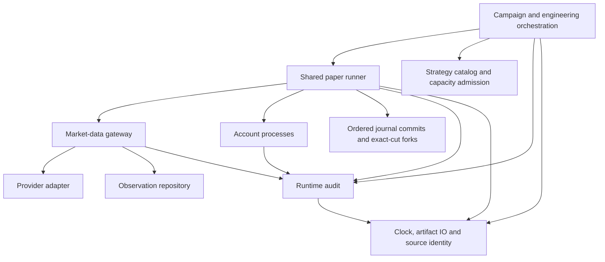

# Runtime maintenance contract

Keep shared mechanisms in one owner. Callers import that owner directly; compatibility exports
refer to the same implementation. Preserve the existing paper-account economics and artifact
formats. The constrained and historical free-simulation rules remain distinct.

## Dependency direction

Results and failures feed the next review as data. Low-level modules do not import the
orchestrator to invoke that review. Type-only references are not execution dependencies.

| Shared responsibility | Owner | Contract retained |
| --- | --- | --- |
| UTC wall time | `papertrade/clock.py` | Aware datetime and ISO text are separate interfaces |
| JSON encoding and file replacement | `papertrade/jsonio.py` | Explicit byte profiles; fsync and private-file rules preserved |
| Repository and input identities | `tools/source_identity.py` | Paths, bytes, executable bits and symlink targets |
| Historical SQLite metadata | `tools/research_metadata.py` | Caller encoding and missing-value policy |
| Supported strategy configurations | `tools/strategy_catalog.py` | Existing options and ordering |
| Recorded capacity admission | `tools/capacity_admission.py` | Existing validity and latency requirements |
| Legacy KR account state | `tools/kr_comparison_account.py` | Independent of comparison orchestration |
| Legacy KR event output | `tools/kr_comparison_events.py` | Existing event fields and output ordering |
| Runtime diagnostics and health | `tools/runtime_audit.py` | Sanitized incidents, explicit recovery and independent monitoring |

Different JSON profiles are intentional. Changing Unicode escaping, field ordering, numeric
serialization or newline rules would invalidate old hashes and journals. Share the implementation
without silently changing those contracts.

## Audit ownership

Pure helpers raise their original errors. Their owning runtime records failures at operation,
task, IPC and process interfaces. This avoids adding identical exception handlers to every helper.
Recovered service conditions resolve the corresponding incident. Repeated incidents aggregate;
an open error cannot be downgraded by a later warning.

The runtime captures Python warnings, created logging diagnostics, unhandled asyncio failures and
thread failures within a scoped process owner. Records contain safe origin, line, category and
exception metadata. Raw diagnostic messages, credentials and authentication headers are omitted.
Hooks and warning filters are restored on exit. Existing warning-as-error policies retain their
first-match precedence and exception behavior. Calls through the scoped `warnings.warn` and
`warnings.warn_explicit` functions are recorded when their warning is raised, even if the caller
catches it. Previously bound aliases and C-extension emitters bypass those function hooks.
Their displayed warnings and warning exceptions escaping the diagnostic scope remain visible,
while exceptions caught internally at those bypasses can be missed. Normal cancellation, polling
timeouts and orderly peer shutdown remain control flow. Unexpected cleanup failures are recorded
without replacing the original exception.

| Runtime role | Error and warning owner |
| --- | --- |
| Shared data gateway and observation store | Request validation, IPC rejection, provider outcomes, lookup and publish operations |
| Provider adapter | Calls, cooldowns, calendar validation, connection failure and recovery |
| Shared features | Computation operations and invalid market observations |
| Account evaluation | Worker execution, result validation, disconnect and acknowledgement |
| Ordered dispatch | Cut ordering, backlog, task failure and incomplete comparison exclusion |
| Strategy registry | Configuration validation and policy-version operations |
| Account forks | Copy operation and committed state requirements |
| Journal and recovery | Durable append, rollback and replay interfaces |
| Campaign operations | Tick, session polling and blocked-session handoff |
| Evidence and capacity | Coverage, projections and measurement interfaces |
| Strategic review | Launch, poll, model response and cleanup |
| Engineering supervision | Step, test job, review and publication interfaces |

Audit storage failure emits emergency evidence and marks the audit unhealthy. Economic commits
must stop until a new validated recovery can establish usable storage. A process killed by the
OS cannot record its own last instruction; the independent observer detects the missing process.
Intentionally disabled logging calls produce no log record to capture.

Completed work can persist adjacent idle heartbeats and incident recoveries in one synchronous
audit transaction. A recovery with no matching open incident in the shared database does not
take the SQLite writer lock. Active health markers, account result checks, economic appends and
acknowledgements keep their existing boundaries. There is no time window or pending audit buffer
to drain on shutdown.

## Regression gates

`python -m tools.check_architecture` checks production import cycles, including lazy imports,
and identical executable function bodies. The full test suite also enforces low-level import
direction and complete transitive source coverage in the frozen runtime manifest. Exact AST
matching is a regression guard, not a proof that every semantically similar algorithm is identical.

The local gate in `tools/local_validation.py` runs Ruff, whole-repository mypy and all tests.
It rejects skipped or empty suites and source changes during validation. Golden-byte tests cover
artifact compatibility. Process, storage, malformed-input and diagnostic-hook tests exercise
failure paths. Keep the validation logs and independent review tied to the source being pushed.

Publication updates the open pull request. It does not merge, redeploy, restart a failed historical
run or authorize real brokerage transactions. Sustained live-market performance is a separate check.
