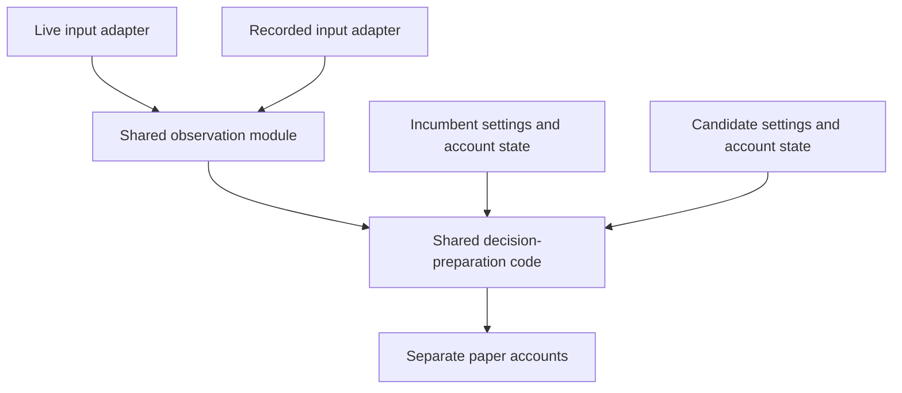

# Shared observation and decision preparation

Status: agreed design direction; not implemented.
Read [Project direction](project-direction.md) for the product goal and strategy responsibilities.

## Goal

Live execution and recording replay must interpret the same observations with the same code.
Replay reproduces actual observation order and decision timing, including processing delay.
It may run faster than wall-clock time without removing recorded delays from the logical clock.
An idealized zero-delay experiment is a different experiment and must be labelled separately.

Equality means identical prepared events and account outcomes for the same observation trace,
strategy version, initial account state, and execution assumptions. Different incumbent and
candidate strategies may legitimately choose different symbols, quantities, and actions.

## Current differences

| Concern | Live runner | Recording replay |
| --- | --- | --- |
| Decision time | Processing-time `now()` | Recorded receipt time |
| Equal-time ordering | Publication order | Symbol ID and per-symbol index |
| Candidate features | Stored candle features in the candidate count | Latest known book applied per candidate |
| Selection | Replaced by live scans | Frozen eligible set |
| Idle expiration | Clock events call `advance` | Book events drive expiration; close does not advance time |
| Recording input | `market.jsonl.gz` | `core-frames.jsonl.gz` and separate REST/FX files |

These are confirmed implementation differences, not measured estimates of their profit impact.
See `Runtime.publish/consume` in `tools/run_async_live_validation.py`, `replay_case/read_recording`
in `tools/replay_layered_stream.py`, and `AsyncLayeredPaper.advance/close`.

## Responsibilities and interface

The module is in-process computation and observation state. It performs no HTTP requests,
websocket operations, file reads, model calls, sleeps, or ledger mutations.
Live acquisition and recorded-file reading remain in their input adapters.
Use the existing `Feature` and account input concepts; a new transport framework is unnecessary.

| Operation | Input | Observable result |
| --- | --- | --- |
| Apply an observation | Ordered event, original payload, source and receipt evidence | Updated as-observed market state or explicit rejection |
| Prepare an account event | That market state, explicit decision time, fixed strategy settings, account exclusions | Feature, eligibility, entry permission, candidate count, quote and FX for account submission |

The shared implementation owns freshness and as-of feature calculations, including adjustment
from each candidate's latest valid known book. The same strategy and account filters must be
used to count candidates and evaluate the current symbol.
Keep current numeric freshness, execution-delay, and expiration assumptions unless a separate
behavior change is explicitly made and validated.

Preparation uses each account's policy, selection, entry cadence, holdings, and pending intents.
Candidate counts and cash reservations are account-specific. Shared code does not imply shared
decisions or a shared ledger. Both accounts consume immutable observations; neither can modify
the other's inputs. Protect the union of held and pending symbols when managing subscriptions.

Stock-selection improvements remain possible: transport subscriptions are not a strategy's
entire candidate universe. Record which symbols actually have usable observations and which
were not watched. Comparison evidence cannot imply full-depth coverage of unobserved symbols.

## Observation trace and time

Record events at the common publication point, before strategy-specific interpretation.
Retain the original market payload and a session-scoped sequence number for every published
observation, including feature availability, FX, selection changes, and clock events.
Retain receipt and decision times as distinct evidence:

- Source time belongs to the provider observation; it is not rewritten to match local time.
- Receipt time is when the live adapter publishes the observation to the consumer.
- Sequence identifies publication order, including events with equal timestamps.
- Decision time is captured once when that event reaches decision preparation.
- Clock events retain the time used for account expiration, even when no quote arrives.

Distinguish raw network receipt from publication if the adapter also records an earlier receipt.
Keep the existing distinction between decision-time observations and later fill confirmations.
The current account event's `received_at` field is used as its logical processing time by the
live runner. Preserve that compatibility during the first extraction and retain actual receipt
evidence in the trace; a field rename or schema migration is a separate change.

Replay processes recorded sequence order and injects the recorded decision clock.
It must not replace decision time with the replay machine's current time or receipt time.
An observation is visible only after its recorded publication turn has been applied; a later
same-time feature or FX update cannot become visible early through a timestamp-only lookup.
Do not sort equal-time observations by symbol to reconstruct missing publication order.
Malformed ordering or clock evidence must be visible rather than silently normalized.

The shared preparation code receives time explicitly and never calls `now()` itself.
Published input is copied or immutable so later producer mutation cannot alter prior decisions.

## Existing recordings

Existing recordings may lack publication sequence, decision clocks, selection changes, or idle
clock events. Preserve those recordings and their previous results.
Continue to identify older replays by their actual input format and timing assumptions.
They can support sensitivity experiments but cannot prove exact reproduction of a live run.
Do not manufacture missing evidence or silently relabel an old result as trace-equivalent.
The first exact reproduction tests use complete synthetic traces; later live evidence requires
the new trace to be recorded. No live campaign is started by adopting this design.

## Acceptance criteria

Test through the shared preparation interface and both input adapters, without credentials,
market traffic, or model calls:

1. The same complete trace and account inputs produce identical submitted events through live
   and recorded adapters, including feature values, candidate count, FX, and logical times.
2. Those submitted events produce identical intents, outcomes, reservations, and final account
   state through the existing execution engine with matching settings.
3. Equal-time observations preserve sequence order. Later same-time feature and FX updates do
   not change an earlier decision. Mutating future observations preserves the replay prefix.
4. Recorded processing delay affects freshness and confirmation timing identically in replay.
5. Clock events expire pending intents without requiring another book update. End-of-recording
   behavior follows recorded clocks; closing alone does not invent fills or elapsed time.
6. Candidate counts use valid candidate books and each account's own strategy settings,
   holdings, and pending state. One account's exclusions do not affect the other account.
7. Existing reservation, partial-fill, duplicate-snapshot, ownership, source-time, and
   entry-cadence behaviors remain covered. Cadence limits new entries, not confirmations or exits.
8. Incomplete old recordings are identified as such and are not accepted as exact-live evidence.

## Delivery order

The separately reproduced supervisor transition defects now have controller guards and
regression coverage. They concern GitHub code publication and completion, not runtime strategy
promotion. Next introduce the shared preparation seam with synthetic parity tests, migrate the two
callers, and add trace capture/replay evidence in separate reviewable changes.
Existing recorded experiments retain their versions and results throughout migration.
Numerical live risk limits, strategy promotion criteria, persistent recovery, Korean-market
support, and real broker execution remain separate work described in the project direction.
